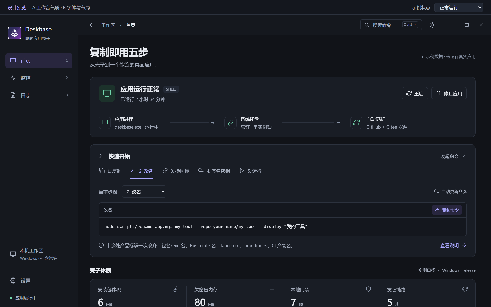
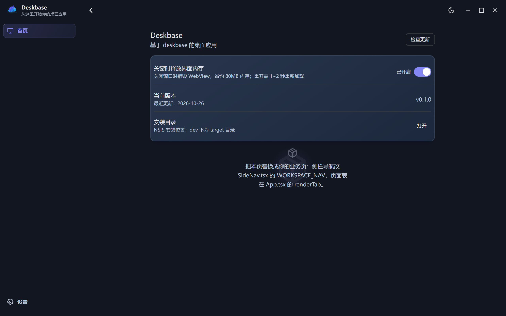
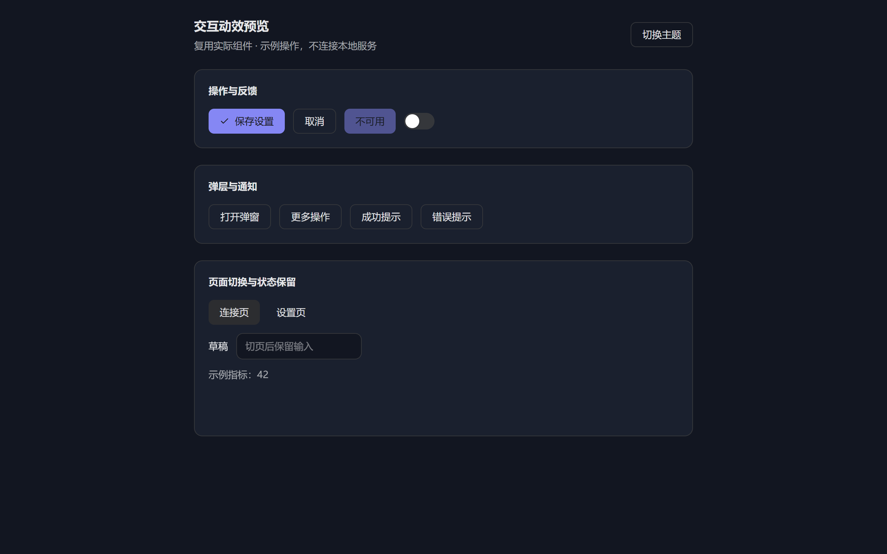
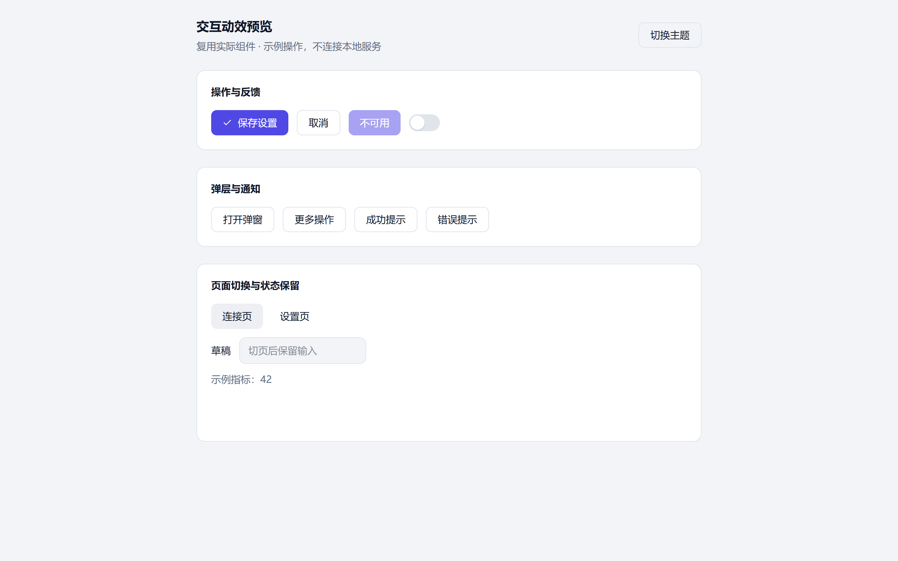

# Deskbase

[](https://github.com/lzlkyb/deskbase/actions/workflows/build.yml)
[](https://opensource.org/licenses/MIT)
[](https://github.com/lzlkyb/deskbase/releases)
[](https://tauri.app)
[](https://react.dev)
[](https://www.rust-lang.org)

**经过生产验证的 Tauri 2 桌面应用模板（壳子）——复制一份、跑一条改名命令，直接开始写业务。**

Deskbase 是一个开源的 Tauri 2 桌面应用脚手架（boilerplate），技术栈为 Tauri 2 + React 18 +
TypeScript + Rust。它不是 Hello World 玩具：每一行都抽离自持续发版的生产桌面应用。
复制仓库 → 一条命令改名 → 十分钟内得到一个**能跑、能自动更新、UI 成体系**的桌面应用，
CI 已配好 Windows + macOS 双平台构建与发版。

## 截图

| Workbench（改名预览） | 改名后的真实应用 |
|:--:|:--:|
|  |  |

| 动效体系 · 深色 | 动效体系 · 浅色 |
|:--:|:--:|
|  |  |

---

## 为什么是 Deskbase

大部分模板只给你一个窗口。Deskbase 给你的是生产环境里真正花时间踩坑的部分：

- **🔐 能面对真实网络的签名自动更新。** 单飞闸（并发检查只放一个）、指数退避、多端点按序回退、
  错误分类码、可撤销的自动重启、一键发版链（`npm run release`：bump 版本 → tag → CI 双平台构建 →
  跨平台合并 `updater.json` → 附到 Release）。附带本地假更新服务器，不发版也能端到端联调整条链路。
- **🎨 设计体系，而不是一个 CSS 文件。** 设计 token（浅/深双主题 × classic/glass 双材质）、
  30+ 可访问组件（按钮/卡片/开关/弹窗/菜单/toast/徽章…）、layout 壳（拖拽区/托盘感知顶栏）、
  动效体系（三档时长 + 统一 easing + `prefers-reduced-motion` 守卫）——由真实浏览器回归测试验证，
  不靠感觉。
- **🧱 桌面端正确的应用骨架。** 系统托盘、单实例锁、关窗销毁 webview（隐藏时省约 80MB 内存）、
  DWM 圆角、命令分层、路径白名单安全原语、JSON 配置持久化。
- **🤖 由机器执行的工程纪律。** 每次 push 前本地 7 项门禁（组件体量/fmt/eslint/tsc/vitest/
  clippy/cargo test），CI 同标准把关。版本号单一真源。模板用它教的标准要求自己。
- **📦 体积小巧。** NSIS 安装包约 3.2MB。引新依赖前先论证二进制体积增量（红线 15MB）。

### 三层资产

| 层 | 内容 | 位置 |
|----|------|------|
| 🎨 UI 风格架构 | 设计 token（浅/深 × classic/glass）+ 30+ 组件 + layout 壳 + 动效体系 | `desktop/src/index.css` `desktop/src/components/ui/` `desktop/src/lib/motion.ts` |
| ⚙️ 技术架构 | 托盘 + 单实例 + 窗口生命周期 + DWM 圆角 + 命令分层 + 路径安全 + JSON 配置 | `desktop/src-tauri/src/main.rs` `desktop/src-tauri/src/commands/` `desktop/src-tauri/src/security/` |
| 🔄 更新架构 | 单飞闸 + 退避 + 错误分类 → 前端状态机 → 可撤销重启 → 一键发版 + 跨平台 updater 合并 + CI | `desktop/src-tauri/src/commands/update.rs` `desktop/src/contexts/UpdateContext.tsx` `desktop/scripts/release.mjs` |

不含任何业务代码——那是你的拷贝要做的事。

---

## 快速开始（复制即用，5 步）

**前置条件：** Node 22+、Rust stable、[Tauri 2 系统依赖](https://tauri.app/start/prerequisites/)
（Windows：WebView2 + VS C++ Build Tools；macOS：Xcode CLT）。

```bash
# 1. 复制壳子（整目录拷贝，git 历史可选保留）
cp -r deskbase my-app && cd my-app/desktop

# 2. 一键改名：十七处产品标识一次改齐（Cargo 包名/exe 名、Rust crate 名、tauri.conf、
#    package.json、branding.rs 托盘文案、about.ts、HTML 标题、CI 产物名……）
#    漏改的典型症状：托盘 tooltip 还叫 Deskbase、CI 找不到 exe、updater 404、
#    Rust 编译直接 E0432（包名一改 crate 名就变）
node scripts/rename-app.mjs my-tool --repo your-name/my-tool --display "我的工具"

# 3. 换图标（现在用的是壳子占位图）
#    desktop/src-tauri/icons/ —— npx tauri icon your-logo.png 可生成全套；
#    同步更新 desktop/public/icon.png（index.html 骨架屏引它）

# 4. 生成更新签名密钥对（自动更新的命脉，每个应用必须自己签）
#    ⚠️ 壳子自带的是一次性测试公钥（仅供开箱即用的 cargo test 与本地联调），
#    上线前必须换成自己生成的——
npx tauri signer generate -w ~/.tauri/my-tool.key
#    公钥 → desktop/src-tauri/tauri.conf.json 的 plugins.updater.pubkey
#    私钥 → GitHub 仓库 Settings → Secrets → TAURI_SIGNING_PRIVATE_KEY（整个文件内容）
#    另：发布前删掉 tauri.conf.json 里的 dangerousInsecureTransportProtocol 本地联调开关

# 5. 跑起来
npm install
npm run tauri dev
```

> 首次安装若报 `Cannot read properties of null (reading 'edgesOut')`，是 npm 10.9.x +
> vitest 4 可选 peer 的已知 bug：加 `--legacy-peer-deps` 跑一次生成 lockfile 之后即恢复正常。

`npm run tauri dev` 起来后能看到：左侧导航（首页/监控/设置）、顶栏（拖拽区/主题切换/更新状态）、
首页示例、设置页（自动开机 + 更新历史弹框）、托盘菜单（打开面板/检查更新/退出）。

## 目录结构

```
deskbase/
├── CLAUDE.md                     # 工程纪律（AI 协作规则，改代码前先读）
├── CHANGELOG.md                  # Keep a Changelog 唯一手写源（更新弹框内容从这抽）
├── .github/workflows/build.yml   # CI：前端门禁 + Rust 测试 + tag 双平台发版
├── .githooks/pre-push             # 7 项本地门禁（启用：git config core.hooksPath .githooks）
└── desktop/
    ├── src/
    │   ├── index.css             # 设计 token 体系（改 UI 先读它）
    │   ├── App.tsx               # 应用骨架：页面表/Ctrl+1~N/过渡动效
    │   ├── components/
    │   │   ├── ui/               # 30+ 基础组件（按钮/卡片/开关/弹窗/徽章…）
    │   │   ├── layout/           # Header + SideNav（拖拽区/徽章/更新状态）
    │   │   ├── update/           # 更新 UI 全家桶（徽章/弹框/进度/可撤销重启）
    │   │   └── tabs/             # 示例页：HomeTab / SettingsTab（照抄改）
    │   ├── contexts/UpdateContext.tsx   # 更新状态机 idle→…→ready→重启
    │   ├── hooks/                # useAppHidden（窗口隐藏停轮询）等
    │   └── lib/                  # 主题/动效/平台/配置 等纯函数
    ├── scripts/                  # 发版链（见下）
    └── src-tauri/
        ├── src/main.rs           # 托盘/单实例/窗口生命周期/DWM 圆角
        ├── src/commands/         # system.rs（配置/自启/外部打开）+ update.rs
        ├── src/security/path.rs  # 路径白名单（canonicalize + 祖先遍历）
        └── tauri.conf.json       # 产品标识/updater 端点/NSIS 配置
```

## 更新架构怎么工作

```
用户点「检查更新」
  → Rust commands/update.rs：单飞闸（并发只放一个）+ endpoints 多源按序回退
      + 指数退避重试 + classify_update_error 错误分类码 + update:* 事件
  → 前端 UpdateContext：idle→checking→available→downloading→ready→error/uptodate
  → 用户点「重启安装」：8 秒可撤销倒计时 → tauri-plugin-process 重启
  → 发版时：npm run release → tag → CI build-macos → build-windows
      → generate-updater-json.mjs 跨平台合并 → updater.json 附到 Release
      → 客户端下次启动时读到新版本
```

本地联调更新链路（不发版也能验证）：

```bash
# 终端 1：起一个假的更新服务器（serve 当前 dist 的产物 + updater.json）
node desktop/scripts/fake-update-server.mjs --dir desktop/src-tauri/target/release/bundle/nsis

# 终端 2：把 dev 应用的更新端点指到假服务器
APP_UPDATE_ENDPOINT=http://127.0.0.1:8787/updater.json npm run tauri dev
```

## 常用命令

```bash
cd desktop

npm run tauri dev        # 开发（前端 HMR；改 Rust 需重启）
npm run vite:build       # 只构建前端（tsc + vite）
npm test                 # vitest 单测
npm run lint             # eslint（react-hooks 规则是重点）
npm run motion:check     # 真实浏览器动效回归（重型手动项：需 npx playwright install，
                         # 且先起 vite preview 让 motion-preview.html 在 1425 端口可达）

cd src-tauri
cargo clippy --all-targets --no-default-features -- -D warnings
cargo test  --no-default-features     # 单测 + tests/update_flow.rs 集成测试
                                     # （本地假源无头跑通「检查→下载→验签失败」）

cd desktop && npm run release -- --patch    # 发版（tag，见 CLAUDE.md「发版流程」）
```

## 工程纪律

每次 push 前本地钩子跑 7 项门禁，CI 同标准：

| # | 门禁 | 拦什么 |
|---|------|--------|
| 1 | 组件体量（≤300 行、≤8 个状态/文件，棘轮基线） | 上帝组件 |
| 2 | `cargo fmt --check` | 格式漂移 |
| 3 | `eslint`（react-hooks 规则） | tsc 看不出的闭包陈旧值 |
| 4 | `tsc --noEmit` | 类型漏洞 |
| 5 | `vitest` | 纯逻辑回归 |
| 6 | `cargo clippy -D warnings` | Rust lint 欠账 |
| 7 | `cargo test --no-default-features` | 更新链路断裂 |

动手前的自检：引新依赖 → 先论证体积增量（NSIS ≤ 15MB 红线）；加后台循环 → 过
`CLAUDE.md` §8.1 六条检查项（让出点/生产端异常/流结束信号/单轮成本/兜底上限/平台分支验证）；
改 UI → 先读真实组件源码，再出 HTML 设计稿，确认后落代码。

## 沉淀在壳子里的生产经验

- 关窗**销毁** webview 省约 80MB 内存（`release_webview_on_close`），靠托盘重生；退出用
  `ExitRequested{code:None}` 拦截。
- 窗口不可见时**必须**停轮询：`useAppHidden` + `refetchInterval: false`。
- `updater.json` **跨平台合并**（`UPDATER_MERGE_INTO`）：两个平台各产片段，Windows 侧统一合并——防互覆。
- 镜像失败不能静默：push 后必须回头验证客户端实际读的 raw 地址且版本号匹配。
- 组件体量红线（300 行 + 8 个状态）由 `check-component-size.mjs` 机器执行，棘轮式管理存量。
- 匹配第三方 crate 的**平台相关 enum 变体**（如 updater 的 `Extract` 仅 Windows 存在）必须给
  match 臂加 `#[cfg]` 隔离——本地单平台验证照不亮这盏灯，靠 CI 双平台 job 兜底。

---

## English

**Deskbase** is a production-proven, open-source **Tauri 2 desktop app template** (boilerplate /
starter) built with Tauri 2, React 18, TypeScript and Rust. Copy the repo, run one rename command,
and in ten minutes you have a running desktop app with **signed auto-updates, a complete design
system, tray integration and dual-platform CI** — every line extracted from a shipping production
desktop app, not written for a demo.

**Three layers included:**

- **Signed auto-update that survives the real world** — single-flight guard, exponential backoff,
  multi-endpoint fallback, typed error classification, undoable auto-restart, one-command release
  chain (`npm run release`), cross-platform `updater.json` merging, plus a local fake-update server
  for end-to-end testing without deploying.
- **Desktop-correct app skeleton** — system tray, single-instance lock, window destroy/recreate
  (~80 MB saved while hidden), DWM rounded corners, command layering, path-whitelist security
  primitives, JSON config persistence.
- **A design system, not a CSS file** — tokens (light/dark × classic/glass), 30+ accessible
  components, layout shell, and a motion system with a `prefers-reduced-motion` guard, verified by
  real-browser regression tests.

**Quick start:**

```bash
cp -r deskbase my-app && cd my-app/desktop
node scripts/rename-app.mjs my-tool --repo your-name/my-tool --display "My Tool"
npm install && npm run tauri dev
```

Then replace the placeholder icons and generate your own signing key pair
(`npx tauri signer generate -w ~/.tauri/my-tool.key`) — see the Chinese quick-start above for the
full five steps. Seven local gates (component size / fmt / eslint / tsc / vitest / clippy /
cargo test) run on every push; CI holds the same bar.

**Topics:** Tauri 2 · desktop app template · boilerplate · React · TypeScript · Rust · auto-update ·
tray · cross-platform · Windows · macOS

## 贡献

Issue 和 PR 都欢迎。请保持门禁全绿（`.githooks/pre-push` 会跑完 7 项），提交信息遵循
`CLAUDE.md` 的前缀规范。

## 许可

[MIT](LICENSE) © Deskbase contributors
